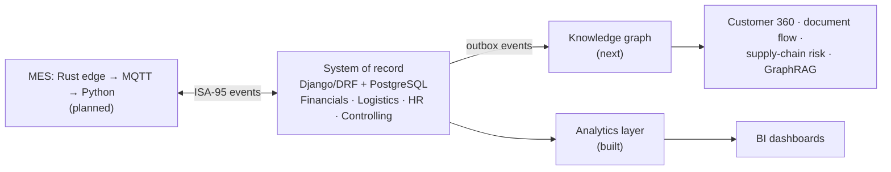

# ERP-Intelligence

[](https://github.com/mokwenaanthony-dev/ERP-Intelligence/actions/workflows/ci.yml)


[](LICENSE)

An ERP built to be **connected and AI-ready**, not just transactional. The core is an SAP-style
modular monolith on Django/DRF and PostgreSQL: a Universal Journal that every module posts to,
immutable documents, and business rules in a service layer. On top of it come two read models: an
**analytics layer** for totals over time, and a **knowledge graph** that turns the links between
partners, materials, documents and cost centres into a semantic layer. That graph supports
Customer 360, document flow, supply-chain risk and GraphRAG for enterprise AI agents. A companion MES
project (Rust edge agents, MQTT, Python) will keep shop-floor activity in step with the books through
the ISA-95 model.

**Built today:** Financials, stock, order-to-cash, procure-to-pay, HR with South African payroll,
cost and profit centres, and an analytics layer with financial statements and margin analysis. 375 tests, 99% coverage, CI with linting, security scanning and dependency
auditing. **Next:** BI dashboards, then the knowledge graph.
Read the [architecture and vision](docs/ARCHITECTURE.md) for the full design.



## Roadmap

| Wave | Scope | Status |
|---|---|---|
| 0 | Foundation: roles and permissions, audit trail, sales orders with stock rules, request logging, tests, CI | Done |
| 1 | Org structure, Business Partner, Material master, Finance core (Universal Journal, fiscal periods, VAT) | Done |
| 2a | Stock-movement ledger: movement types, moving-average valuation, automatic journal postings, stock reconciliation | Done |
| 2b | Order-to-Cash on Business Partner and Material: order, delivery, invoice, payment, open items and ageing | Done |
| 2c | Procure-to-Pay: purchase order, goods receipt, supplier invoice with three-way match, payment, GR/IR | Done |
| 3 | HR (org units, positions, employees), South African payroll posting, cost and profit centres | Done |
| 4a | Analytics layer: reporting views (materialized on PostgreSQL), income statement, balance sheet, margin analysis, stock ageing, payroll cost trend | Done |
| 4a+ | BI dashboards (Metabase) on the reporting views | Next |
| 4b | Knowledge graph: event outbox, graph projection, Customer 360, document flow, supplier dependency, GraphRAG API | Next |
| 5 | Production planning: bills of materials, routings, production orders | Planned |
| 6 | MES integration: MQTT / Unified Namespace bridge mapped to ERP postings (ISA-95) | Planned |
| 7 | CRM and SRM | Planned |
| 8 | SCM: ML demand forecasting, MRP, supply-chain risk on the graph | Planned |
| 9 | PLM and digital twin | Planned |

## What Wave 0 delivers

| Area | What exists |
|---|---|
| Identity | Custom `User` with 8 roles; JWT login, refresh and logout (blacklist) |
| Access control | One permission class per module with read and write role lists (matrix below) |
| Audit | Every record has `created_at`, `updated_at`, `created_by`, `updated_by`, filled automatically by the API and the admin |
| Inventory and sales | Simple products, customers and orders (retired in Wave 2b; see release `v0.1.0`) |
| Telemetry | `OperationalPerformanceMiddleware`: one line per request to stdout and a rotating 10 MB x 5 file. Paths only, never query strings or bodies |
| Ops | `/api/health/`, gunicorn + WhiteNoise, non-root Docker image with healthcheck, Compose stack |
| Quality | pytest suite with an 80% coverage floor; GitHub Actions: flake8, bandit, pip-audit, migrations check, tests on PostgreSQL, Docker build |

## What Wave 1 delivers

| Area | What exists |
|---|---|
| Organisation | Company codes (own currency, chart of accounts, fiscal-year start month), plants, storage locations, sales and purchasing organisations |
| Master data | Currencies and dated exchange rates (inverse rates used automatically), units of measure, Business Partner with per-company customer and supplier roles, Material master |
| Chart of accounts | G/L accounts by type; reconciliation accounts for receivables and payables that only accept postings with a matching business partner |
| Fiscal calendar | Fiscal years named by the year they end in (FY2027 = March 2026 to February 2027), 12 posting periods each, opened and closed by the Finance Manager |
| VAT | Tax codes per chart (15% output and input, zero-rated, exempt); the tax line is calculated and added automatically, rounded half-up |
| Universal Journal | One line-item table for every posting, modelled on S/4HANA's ACDOCA: company code, period, account, partner, material, plant, tax code, document and company currency, signed amounts, no stored totals |
| Posting rules | Balanced debits and credits, open period, valid account and partner, gap-free document numbers per company code, fiscal year and document type, all in one transaction |
| Corrections | Posted documents cannot be edited or deleted; reversal posts a mirror document and links the two |
| Reporting | Trial balance computed straight from the journal |
| Demo data | `python manage.py setup_demo_company` builds a South African company: ZAR, chart CAZA, VAT codes, fiscal year, partners, materials and two sample postings |

### Posting a journal entry

```http
POST /api/finance/journal-entries/
{
  "company_code": "1000",
  "document_type": "DR",
  "posting_date": "2026-05-15",
  "reference": "INV-0042",
  "lines": [
    {"gl_account": "1100", "debit_credit": "D", "amount": "2300.00", "business_partner": "1000001"},
    {"gl_account": "4000", "debit_credit": "C", "amount": "2000.00", "tax_code": "O1"}
  ]
}
```

The response is document `DR00000002` with three lines: the 15% output VAT line (R300.00 to account 2100)
is added by the system.

## What Wave 2a delivers

| Area | What exists |
|---|---|
| Movement types | 561 initial stock, 101 goods receipt, 601 goods issue for delivery, 551 scrapping, 701/702 physical inventory gain/loss, 311 transfer between storage locations |
| Material documents | Immutable, numbered (`MD00000001`), reversible; items carry signed quantities and values per storage location |
| Valuation | Moving average price per material and plant, always computed from the movements (no stored totals); issuing all stock takes the full remaining value, so no cents are left behind |
| Accounting | Every value-changing movement posts a journal entry in the same transaction (`WE` receipts, `WA` issues, `WI` count differences), with material and plant on each line |
| Account determination | Inventory, GR/IR clearing, initial entry, cost of sales, scrapping and inventory-difference accounts per chart, optionally per material type |
| Controls | Stock checked per storage location; closed periods blocked; reversals refused if the stock has already been issued or would leave value without quantity |
| Reports | Stock overview (quantity per storage location, value and moving average price per plant) and a stock-to-ledger reconciliation that proves stock value equals the inventory account balance |

### Posting a goods receipt

```http
POST /api/inventory/goods-movements/
{
  "movement_type": "101",
  "plant": "1000",
  "posting_date": "2026-05-15",
  "business_partner": "1000002",
  "items": [{"material": "TG-1001", "storage_location": "0001", "quantity": "50", "unit_price": "150.00"}]
}
```

Creates material document `MD00000002` and journal entry `WE00000002` (Dr 1200 Inventory R7,500 /
Cr 2300 GR/IR clearing R7,500). The moving average price of TG-1001 moves from R120 to R130.

## What Wave 2b delivers

```
Sales order --> Delivery --------------> Invoice --------------------------> Payment
 (prices,       601 goods issue:          Dr Receivables (gross)             Dr Bank
  VAT code)     Dr Cost of sales          Cr Revenue (net) / Cr VAT output   Cr Receivables
                Cr Inventory (moving avg)                                     clears the open item
```

| Area | What exists |
|---|---|
| Pricing | Sales prices per material and sales organisation with validity dates; manual price override flagged on the item |
| Sales orders | On Business Partner (customer role) and Material; VAT code defaulted per material type; OPEN (editable) -> CONFIRMED -> COMPLETED, or CANCELLED; delivered and invoiced quantities derived from the documents |
| Deliveries | Full or partial, per plant; post a 601 goods issue that books cost of sales at moving average; reversible until invoiced |
| Invoices | One per delivery: receivable (gross), revenue (net) and output VAT per item, due date from the customer's payment terms; cancellable while unpaid |
| Payments and open items | Incoming payments clear receivables (explicitly or oldest first, partial allowed); reversing a payment re-opens its items; open-item list per customer |
| Reports | Receivables ageing (not due, 1-30, 31-60, 61-90, over 90 days) and a receivables-to-ledger reconciliation |
| Numbering | `SO`, `DL` and `IN` numbers run continuously per company code; accounting documents keep their yearly `WA`, `DR`, `DZ` ranges |

The Wave 0 sales `Customer`/`SalesOrder` and inventory `Product` models were retired in this wave
(migration `sales/0002_retire_wave0_sales_models`).

### Order to cash in five calls

```http
POST /api/sales/orders/                     {"sales_organization": "1000", "customer": "1000001", "order_date": "2026-05-10",
                                             "items": [{"material": "TG-1001", "quantity": "10"}, {"material": "TG-1002", "quantity": "2"}]}
POST /api/sales/orders/1/confirm/
POST /api/sales/orders/1/deliver/           {"delivery_date": "2026-05-12", "storage_location": "0001"}
POST /api/sales/invoices/                   {"delivery": 1, "invoice_date": "2026-05-15"}
POST /api/finance/incoming-payments/        {"company_code": "1000", "customer": "1000001", "payment_date": "2026-06-10",
                                             "amount": "3436.20", "bank_account": "1000"}
```

Result: order `SO00000001` (R2,988.00 net), delivery `DL00000001` with goods issue `WA00000001`
(cost of sales R1,800), invoice `IN00000001` / `DR00000002` (R2,988.00 + R448.20 VAT = R3,436.20),
payment `DZ00000001` clearing the oldest open items first.

## What Wave 2c delivers

```
Purchase order --> Goods receipt ---------> Supplier invoice -----------------------> Payment
 (supplier,        101 at the order price:   three-way match (order, receipt, invoice)  Dr Payables
  price, VAT)      Dr Inventory              Dr GR/IR (order price)                     Cr Bank
                   Cr GR/IR                  Dr/Cr Price differences                    clears the open item
                                             Dr VAT input / Cr Payables (gross)
```

| Area | What exists |
|---|---|
| Purchase orders | On Business Partner (supplier role) and Material, per purchasing organisation; price per item, receiving storage location and input VAT code defaulted; OPEN (editable) -> RELEASED -> COMPLETED, or CANCELLED; received and invoiced quantities derived from the documents |
| Goods receipts | Full or partial, per plant, into any storage location; post a 101 at the order price (Dr inventory / Cr GR/IR, supplier on the line); no over-delivery; reversible until invoiced |
| Supplier invoices | Matched to the order and receipts: quantity never above received-not-invoiced, unit price within the tolerance (5% in the demo company), duplicate supplier invoice numbers rejected; GR/IR cleared at the order price, the difference to the price difference account (5300), input VAT per line, due date from the supplier's payment terms; cancellable while unpaid |
| Payments and open items | Outgoing payments clear payables with the same rules as incoming payments; open items per supplier (`type=supplier`) |
| Reports | Payables ageing, payables-to-ledger reconciliation, and the GR/IR report: goods received not invoiced per order item, checked against the GR/IR ledger balance |
| Configuration | `PurchasingAccountSetting` per chart of accounts: default input VAT code, price difference account, price tolerance |
| Numbering | `PO`, `GR` and `IV` numbers run continuously per company code; accounting documents keep their yearly `WE`, `KR`, `KZ` ranges |

Design choice: because stock is valued at moving average, an invoice price difference goes to the
price difference account rather than back into stock value, so the stock ledger and the inventory
account always reconcile. Stock-value adjustment from invoices can follow with standard costing.

### Procure to pay in five calls

```http
POST /api/purchasing/orders/                {"purchasing_organization": "1000", "supplier": "1000002", "order_date": "2026-05-04",
                                             "items": [{"material": "TG-1001", "quantity": "50", "net_price": "125.00"},
                                                       {"material": "TG-1002", "quantity": "20", "net_price": "310.00"}]}
POST /api/purchasing/orders/1/release/
POST /api/purchasing/goods-receipts/        {"purchase_order": "PO00000001", "receipt_date": "2026-05-11"}
POST /api/purchasing/invoices/              {"purchase_order": "PO00000001", "supplier_reference": "HS-9001",
                                             "invoice_date": "2026-05-15"}
POST /api/finance/outgoing-payments/        {"company_code": "1000", "supplier": "1000002", "payment_date": "2026-06-10",
                                             "amount": "14317.50", "bank_account": "1000"}
```

Result: order `PO00000001` (R12,450.00 net), receipt `GR00000001` with material document `MD00000002`
and `WE00000002` (Dr inventory / Cr GR/IR R12,450), invoice `IV00000001` / `KR00000001`
(R12,450.00 + R1,867.50 VAT = R14,317.50, GR/IR back to zero), payment `KZ00000001`.

## What Wave 3 delivers

```
Org unit (cost centre) --> Position --> Employee --> Payroll run (one per month) --> Journal entry PY
                                                     PAYE (SARS table), UIF, SDL     Dr salaries, UIF, SDL  per cost centre
                                                                                      Cr PAYE / UIF / SDL payable, salaries payable
Cost centre --> Profit centre <-- Plant           every journal line can carry both dimensions
```

| Area | What exists |
|---|---|
| Controlling | Profit centres and cost centres per company code (cost centre categories, active flag); plants default to a profit centre |
| Journal dimensions | Every journal line can carry a cost centre and a profit centre. The profit centre is derived from the cost centre, else the plant, so stock, cost of sales, revenue and price differences land on a profit centre automatically. Cost centres only on expense accounts; accounts can require one (payroll accounts do); reversals keep both |
| Reports | Cost centre actuals per cost element (expense account), profit centre result (revenue, expenses, result, with an "Unassigned" line), both by fiscal year and period range |
| HR | Org units (hierarchy, cost centre), positions (cost centre override), employees with system-assigned personnel numbers, hire and termination dates and monthly salary; HR admin only |
| Payroll | One run per company code and month for everyone employed in it: PAYE from the SARS table for the year of assessment (2027 table loaded, primary rebate), UIF 1% + 1% up to the R17,712 ceiling, SDL 1%; posts one journal entry (PY) with costs per cost centre and the liabilities; reversible, then re-run |

Simplifications for now: monthly salary only (no allowances, overtime, medical aid, retirement funding or
age rebates), no part-month proration, and salary payment is posted as an ordinary journal entry
(Dr 2500 salaries payable / Cr bank). Load each new SARS table before running March payroll.

### Payroll in one call

```http
POST /api/hr/payroll-runs/      {"company_code": "1000", "year": 2026, "month": 5}
```

Result for the three demo employees: run `PR00000001`, journal entry `PY00000001` on 31 May 2026.
Gross R135,500.00, PAYE R31,757.50, UIF R531.36 + R531.36, SDL R1,355.00, net pay R103,211.14,
costs on cost centres 1000 (R86,027.12), 2000 (R32,497.12) and 3000 (R18,862.12).

## What Wave 4a delivers

```
Universal Journal, material documents, payroll results
        |  plain SQL, one definition per view
        v
Reporting views (materialized on PostgreSQL, refreshed CONCURRENTLY every 15 min by Celery beat;
                 ordinary live views on SQLite)
  analytics_gl_period_balance   analytics_sales_margin   analytics_stock_position   analytics_payroll_cost
        |
        v
Management reports (API): income statement · balance sheet · sales margin · stock ageing · payroll cost
```

| Area | What exists |
|---|---|
| Reporting views | Four views over the transactional tables, each with a unique `row_key`. On PostgreSQL they are materialized views with a unique index, refreshed `CONCURRENTLY` so readers are never blocked; on SQLite the same SQL is an ordinary view |
| Refresh | Celery beat every 15 minutes (`celery_beat` service in Compose), `python manage.py refresh_analytics`, or `POST /api/analytics/refresh/`. Every report returns `materialized` and `data_as_of` so users know how current the numbers are |
| Income statement | Revenue, cost of sales, gross margin and %, operating expenses, result; per-period trend; optionally per profit centre and period range |
| Balance sheet | Assets, liabilities and equity at the end of any period, carried forward across years; result to date shown in equity until year-end closing exists; `balanced` check |
| Margin analysis | Revenue, cost of sales and gross margin by customer, material or profit centre, straight from the journal (revenue from invoices, cost of sales from goods issues) |
| Stock ageing | Stock on hand per material and plant, aged by days since the last receipt (0-30, 31-90, 91-180, over 180), with slow movers (no issue for N days) |
| Payroll cost | Posted payroll per month, optionally per cost centre: headcount, gross, employer contributions, total cost |
| Access | Statements: finance. Margins: finance and sales. Stock: finance, warehouse, purchasing. Payroll cost: finance manager and HR only (a one-person cost centre would reveal a salary). Refresh: finance manager |

## Role matrix

| Role | Writes | Reads only |
|---|---|---|
| Finance Manager | finance (incl. configuration, period open/close, payments), customer and supplier invoices, cost and profit centres, payroll runs, currencies and rates, business partners | sales orders, deliveries, inventory, purchase orders, goods receipts |
| Accountant | journal entries, payments, customer and supplier invoices, business partners | payroll runs, controlling reports, finance configuration, sales orders, deliveries, inventory, purchase orders, goods receipts |
| Sales Representative | sales orders, prices, deliveries, invoices, business partners | inventory |
| Inventory Manager | goods movements, goods receipts, delivery reversal, materials | deliveries, purchase orders |
| Purchasing Officer | purchase orders, goods receipts, business partners, materials | inventory, supplier invoices, GR/IR report |
| HR Admin | org units, positions, employees, payroll runs | cost and profit centres |
| Viewer | - | sales orders, deliveries, invoices, inventory, purchase orders, goods receipts, supplier invoices |
| Administrator / superuser | everything, including organisation structure | - |

Every signed-in user can read organisation structure and master data, including cost and profit centres.
Employee records and salaries are visible to HR only.

## API

| Method | Path | Notes |
|---|---|---|
| GET | `/api/health/` | No login needed |
| POST | `/api/auth/token/` | `{"username", "password"}` gives `access` + `refresh` |
| POST | `/api/auth/token/refresh/` | `{"refresh"}` |
| POST | `/api/auth/logout/` | `{"refresh"}`, blacklists it |
| CRUD | `/api/sales/prices/` | `?material=` |
| GET, POST | `/api/sales/orders/` | Filters `status`, `customer` |
| GET, PATCH | `/api/sales/orders/<id>/` | PATCH `{"items": [...]}` replaces items while OPEN; no PUT or DELETE |
| POST | `/api/sales/orders/<id>/confirm/`, `/cancel/` | |
| POST | `/api/sales/orders/<id>/deliver/` | `{"delivery_date", "storage_location"}` or `{"delivery_date", "items": [{"item_number", "quantity", "storage_location"}]}` |
| GET | `/api/sales/deliveries/` | `?sales_order=` |
| POST | `/api/sales/deliveries/<id>/reverse/` | Until invoiced |
| GET, POST | `/api/sales/invoices/` | POST `{"delivery", "invoice_date"}`; filters `customer`, `status` |
| POST | `/api/sales/invoices/<id>/cancel/` | While unpaid |
| GET, POST | `/api/purchasing/orders/` | Filters `status`, `supplier` |
| GET, PATCH | `/api/purchasing/orders/<id>/` | PATCH `{"items": [...]}` replaces items while OPEN; no PUT or DELETE |
| POST | `/api/purchasing/orders/<id>/release/`, `/cancel/` | |
| GET, POST | `/api/purchasing/goods-receipts/` | POST `{"purchase_order", "receipt_date"[, "delivery_note"][, "items": [{"item_number", "quantity", "storage_location"}]]}`; `?purchase_order=` |
| POST | `/api/purchasing/goods-receipts/<id>/reverse/` | Until invoiced |
| GET, POST | `/api/purchasing/invoices/` | POST `{"purchase_order", "supplier_reference", "invoice_date"[, "items": [{"item_number", "quantity", "net_price"}]]}`; filters `supplier`, `status` |
| POST | `/api/purchasing/invoices/<id>/cancel/` | While unpaid |
| GET | `/api/purchasing/reports/gr-ir/` | `?company_code=` |
| GET | `/api/analytics/income-statement/` | `?company_code=&fiscal_year=[&period_from=&period_to=][&profit_center=]` |
| GET | `/api/analytics/balance-sheet/` | `?company_code=&fiscal_year=&period=` |
| GET | `/api/analytics/sales-margin/` | `?company_code=&fiscal_year=[&group_by=customer\|material\|profit_center][&period_from=&period_to=]` |
| GET | `/api/analytics/stock-ageing/` | `?company_code=[&as_of=][&slow_after_days=90]` |
| GET | `/api/analytics/payroll-cost/` | `?company_code=[&year=][&by_cost_center=true]` |
| GET, POST | `/api/analytics/refresh/` | GET: when each view was refreshed; POST: refresh now (finance manager) |
| CRUD | `/api/controlling/profit-centers/`, `cost-centers/`, `plant-profit-centers/` | `?company_code=`; cost centre's profit centre given by code |
| GET | `/api/controlling/reports/cost-centers/` | `?company_code=&fiscal_year=[&period_from=&period_to=][&cost_center=]` |
| GET | `/api/controlling/reports/profit-centers/` | `?company_code=&fiscal_year=[&period_from=&period_to=]` |
| CRUD | `/api/hr/org-units/`, `positions/` | Cost centre given by code |
| CRUD | `/api/hr/employees/` | Personnel number assigned by the system; filters `company_code`, `org_unit`, `active` |
| GET, POST | `/api/hr/payroll-runs/` | POST `{"company_code", "year", "month"[, "posting_date"]}`; filters `year`, `status` |
| POST | `/api/hr/payroll-runs/<id>/reverse/` | Optional `{"posting_date"}` |
| CRUD | `/api/org/company-codes/<code>/`, `plants/<code>/`, `storage-locations/`, `sales-organizations/<code>/`, `purchasing-organizations/<code>/` | |
| CRUD | `/api/masterdata/currencies/<code>/`, `exchange-rates/`, `units/<code>/` | |
| CRUD | `/api/masterdata/business-partners/<number>/` | `?search=` by name; number assigned by the system |
| CRUD | `/api/masterdata/customer-roles/`, `supplier-roles/` | Reconciliation account given by its number |
| CRUD | `/api/masterdata/materials/<number>/` | |
| CRUD | `/api/finance/charts-of-accounts/<code>/`, `gl-accounts/`, `tax-codes/` | |
| GET, POST | `/api/finance/fiscal-years/` | POST creates the year and its 12 periods |
| GET | `/api/finance/periods/` | `?company_code=&fiscal_year=` |
| POST | `/api/finance/periods/<id>/open/`, `/close/` | Finance Manager |
| GET, POST | `/api/finance/journal-entries/` | POST posts (lines take optional `cost_center`, `profit_center` codes); filters `company_code`, `fiscal_year`, `period`, `document_type`, `status` |
| POST | `/api/finance/journal-entries/<id>/reverse/` | Optional `{"posting_date"}` |
| GET | `/api/finance/reports/trial-balance/` | `?company_code=1000&fiscal_year=2027[&period_from=&period_to=]` |
| POST | `/api/finance/incoming-payments/` | Optional `allocations: [{"line_id", "amount"}]`; otherwise oldest first |
| POST | `/api/finance/outgoing-payments/` | Same shape with `supplier` instead of `customer` |
| GET | `/api/finance/reports/open-items/` | `?company_code=&type=customer\|supplier&business_partner=&include_cleared=` |
| GET | `/api/finance/reports/receivables-ageing/` | `?company_code=&as_of=` |
| GET | `/api/finance/reports/receivables-reconciliation/` | `?company_code=` |
| GET | `/api/finance/reports/payables-ageing/`, `payables-reconciliation/` | `?company_code=&as_of=` / `?company_code=` |
| GET, POST | `/api/inventory/goods-movements/` | POST posts; filters `plant`, `movement_type`, `material`, `status` |
| POST | `/api/inventory/goods-movements/<id>/reverse/` | Optional `{"posting_date"}` |
| GET | `/api/inventory/stock/` | `?plant=&material=` |
| GET | `/api/inventory/reports/stock-reconciliation/` | `?company_code=1000` |
| CRUD | `/api/inventory/account-settings/` | Account determination (Finance Manager) |

Send `Authorization: Bearer <access>` on every call except health and auth. A Postman collection is in `postman/`.

## Run it

Python 3.12 or 3.13 is recommended (Django 5.2 LTS).

```bash
python -m venv .venv
.venv\Scripts\activate            # Windows  (macOS/Linux: source .venv/bin/activate)
pip install -r requirements-dev.txt

copy .env.example .env            # macOS/Linux: cp; then set DJANGO_SECRET_KEY
python manage.py migrate
python manage.py seed_data            # one user per role (password ChangeMe123!) + demo company 1000
python manage.py runserver
```

Full stack (PostgreSQL, Redis, Celery worker and beat) with Docker:

```bash
docker compose up --build
docker compose exec web python manage.py seed_data
docker compose exec web python manage.py refresh_analytics   # beat does this every 15 minutes
```

On SQLite the analytics views are ordinary views and always current; on PostgreSQL they are
materialized and refreshed by Celery beat, `refresh_analytics` or `POST /api/analytics/refresh/`.

## Test and check

```bash
pytest                                                       # tests + coverage (fails below 80%)
flake8 .
bandit -r apps erp_system -ll -x "*/migrations/*"
pip-audit -r requirements.txt
python manage.py makemigrations --check --dry-run --settings=erp_system.settings_test
```

The same gates run in `.github/workflows/ci.yml` on every push and pull request.

## Project layout

```
apps/
  accounts/    User, roles, permission classes
  common/      Audit base models, middleware, shared view/admin mixins, seed_data
  organization/  Company codes, plants, storage locations, sales and purchasing organisations
  masterdata/  Currencies, exchange rates, units, Business Partner and roles, Material master
  finance/     Chart of accounts, fiscal calendar, tax codes, Universal Journal, open items and
               payments; services.py holds the posting rules; setup_demo_company command
  inventory/   Stock ledger: material documents, valuation, account determination
  sales/       Prices, sales orders, deliveries, invoices; services.py holds order-to-cash
  purchasing/  Purchase orders, goods receipts, supplier invoices, GR/IR; services.py holds procure-to-pay
  analytics/   Reporting views (sql.py), read-only models, management reports, refresh task and command
  controlling/ Cost and profit centres, plant assignment, cost and profit centre reports
  hr/          Org units, positions, employees, PAYE tables, payroll runs; services.py holds payroll
erp_system/    Settings (settings_test.py for pytest), URLs, Celery
tests/         pytest suite
```

## Licence

MIT. See [LICENSE](LICENSE).
