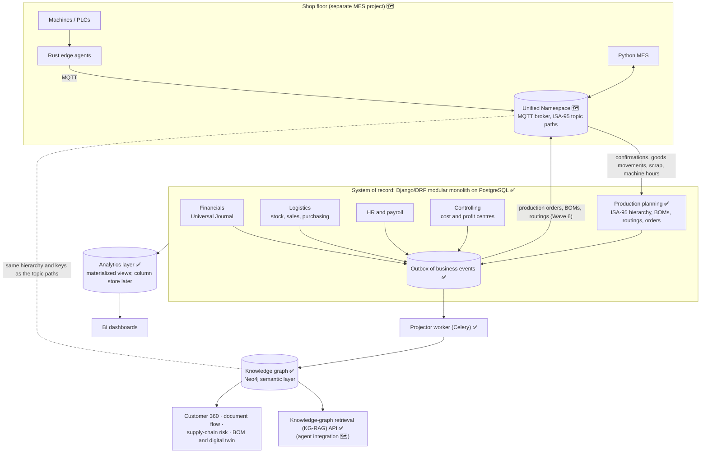

# ERP-Intelligence: architecture and vision

ERP-Intelligence is being built as more than a set of transactional modules. The goal is an ERP whose
data is **connected, explainable and ready for AI agents**, and that can stay in step with a factory's
shop floor. This document explains the target architecture, what is built today, and why the pieces
are ordered the way they are.

> **Status key:** ✅ built and tested · 🔜 next · 🗺️ planned. See the [roadmap](../README.md#roadmap).
> **Why** each choice was made is recorded in the [decision records](decisions/README.md).

## The idea in one picture



## Three layers, three jobs

| Layer | Job | Technology | Status |
|---|---|---|---|
| **System of record** | Every business transaction, with the rules that make the books trustworthy: double entry, gap-free numbering, row locks, immutable documents corrected only by reversal | Django/DRF, PostgreSQL | ✅ Waves 0-3 |
| **Analytics layer** | Totals over time: P&L and balance sheet by period, margin by customer and material, stock ageing, payroll cost trends | PostgreSQL materialized views (refreshed concurrently by Celery beat), then a column store; BI dashboards | ✅ Waves 4a, 4a+ (Metabase dashboards) |
| **Knowledge graph** | Relationships: who is connected to what, across modules, at any depth | Neo4j 5.26 LTS fed from the transactional outbox | ✅ Wave 4b |

The relational core stays the single source of truth. The analytics layer and the knowledge graph are
**read models**: they are rebuilt from the core and never written to directly. Each answers the kind
of question it is best at:

- "What was gross margin per profit centre last quarter?" is an aggregation, so analytics answers it.
- "If this supplier stops delivering, which customers' open orders are at risk?" is a path through
  supplier → purchase orders → materials → sales orders → customers, so the graph answers it in one
  traversal instead of a long chain of SQL joins.

## Why the core is already graph-shaped

The modules built so far link every document to the ones before it and give every journal line the
dimensions of the business:

```
Customer ─┬─ Sales order ── Delivery ── Material document ── Journal entry (WA)
          │                    └─────── Invoice ──────────── Journal entry (DR) ── Payment (DZ)
          └─ Open items ───────────────────────────────────── clearing
Supplier ─── Purchase order ── Goods receipt ── Supplier invoice ── Payment (KZ)
Journal line → business partner · material · plant · cost centre · profit centre
Employee → position → org unit → cost centre → profit centre
```

These links already exist as foreign keys. The knowledge graph makes them first-class nodes and
edges, so they can be traversed, visualised and handed to an AI agent as grounded context.

## Keeping the graph in sync: the outbox pattern ✅

1. Each service in `services.py` (post an invoice, receive goods, run payroll) writes an **event row**
   in the same database transaction as the business posting. If the posting rolls back, so does the
   event, so the two can never disagree.
2. A Celery worker reads new events in order and **upserts** the matching nodes and edges into the graph.
3. Because posted documents are immutable and corrections are separate reversal documents, events
   are append-only. The graph can be rebuilt from scratch at any time by replaying them.

## Knowledge graph, first version ✅

- **Nodes:** BusinessPartner (with Customer and Supplier roles), Material, Plant, StorageLocation,
  CompanyCode, CostCenter, ProfitCenter, Employee, Position, OrgUnit, and the business documents
  (orders, deliveries, receipts, invoices, payments, journal entries, payroll runs).
- **Edges:** `ORDERED`, `DELIVERED_BY`, `BILLED_BY`, `PAID_BY`, `SUPPLIES`, `STOCKED_AT`,
  `POSTED_TO`, `CHARGED_TO`, `BELONGS_TO`, `REPORTS_TO`, and so on.
- **Stable identifiers:** business keys (partner numbers, material numbers, plant codes, document
  numbers), the same keys the MES will use, so shop-floor data joins the graph without mapping tables.
- **First use cases:**
  - **Customer 360:** everything about a business partner across sales, purchasing, receivables,
    payables and stock, in one query.
  - **Document flow:** order → delivery → invoice → payment, and PO → receipt → invoice → payment,
    as a traversal.
  - **Supplier dependency:** materials bought from a single supplier, and the sales they feed.
- **Graph database:** Neo4j 5.26 LTS (Community), chosen over Apache AGE for its tooling (Browser,
  Cypher ecosystem) and recognition. Projection is state-based and idempotent, so the graph can be
  rebuilt from the ERP at any time (`graph_rebuild`).
- **An explicit ontology.** The graph is a labelled property graph, a recognised kind of knowledge
  graph that does not need RDF or OWL. What makes it a *semantic* layer is that every node type and
  relationship has a defined meaning, key and source: these are written down in
  [`docs/ONTOLOGY.md`](ONTOLOGY.md) ✅ (version 1.1, versioned with the code), and Neo4j enforces a uniqueness
  constraint on the business key of every label ✅.

## AI readiness: knowledge-graph retrieval (KG-RAG) (retrieval ✅, agent 🗺️)

Enterprise AI agents give unreliable answers when they guess at SQL over dozens of tables. Grounding
them in the graph means an answer can be traced back to the real orders, invoices and partners it came
from.

**Why "KG-RAG" and not "GraphRAG".** Microsoft's GraphRAG has a language model *extract* a graph from
unstructured text and summarise its communities. Here the graph is *projected* from validated ERP
records, so retrieval returns facts that have no extraction errors and each one traces back to a
document number. The endpoint returns the neighbourhood of a business object as subject, predicate,
object facts with readable text, ready to hand to an agent (`GET /api/graph/context/`).

Two rules carry over from the core:

- **Permissions travel with the data.** The same roles that protect the API filter what the graph
  returns. Salaries, for example, are visible to HR only today and must stay that way for an agent.
- **The graph explains, the core decides.** Agents read from the graph. Any change still goes through
  the service layer and its business rules.

## Unified Namespace and knowledge graph: one vocabulary 🔜

The Unified Namespace (UNS) and the knowledge graph do different jobs and depend on each other:

| | Unified Namespace | Knowledge graph |
|---|---|---|
| Answers | "What is happening **now**?" | "How is everything **connected**?" |
| Holds | Current state and events, published by every system (machines, MES, ERP) | Structure and meaning: equipment, orders, materials, partners, cost centres and their relationships |
| Technology | MQTT broker, one topic per thing, ISA-95 topic paths | Neo4j, fed from the ERP outbox |

The graph gives the UNS its structure: what a topic's equipment is, which line and plant it belongs to,
which order it is running and which customer that order serves. The UNS keeps the graph's digital
twin current. Without a shared structure, a UNS becomes a heap of topics nobody can interpret, and
the graph knows only what the ERP has recorded.

### The shared structure: the ISA-95 equipment hierarchy, owned by the ERP

ISA-95 (IEC 62264) defines a role-based equipment hierarchy. The levels that matter here are:

- **Enterprise → Site → Area**, then
- **Work centre**: equipment grouped and scheduled as one. A *production line* is one kind of work
  centre (others are process cells, production units and storage zones), then
- **Work unit**: the lowest level the MES schedules. A *work cell* is one kind of work unit.

SAP uses "work centre" for the place where a routing operation runs and its activity costs are
charged. That is usually an ISA-95 **work unit** (a cell or a machine), not an ISA-95 work centre.
To keep the two vocabularies apart, the ERP keeps SAP's term on its screens and API, every record
also carries its ISA-95 level, and the graph and the UNS use only the ISA-95 names:

| ISA-95 level (type) | ERP (Wave 5) | Graph label | UNS topic segment |
|---|---|---|---|
| Enterprise | Company code | `CompanyCode` | `1000` |
| Site | Plant | `Plant` | `1000` (plant code) |
| Area | Production area 🔜 | `Area` | `assembly` |
| Work centre (production line) | Production line 🔜 | `Line` | `line-1` |
| Work unit (work cell) | Work centre 🔜 (SAP sense), with routing operations and a cost centre | `Cell` | `press-3` |

The hierarchy is master data, maintained once in the ERP and used with the same codes in all three
places:

- Graph edges: `Cell -PART_OF-> Line -PART_OF-> Area -PART_OF-> Plant -BELONGS_TO-> CompanyCode`, and
  `Cell -CHARGED_TO-> CostCenter`, so a machine hour can be followed to the profit and loss account it
  lands on.
- Every equipment node carries its ISA-95 level and its `uns_path` (e.g. `1000/1000/assembly/line-1/press-3`),
  so a graph query, or an AI agent using KG-RAG, also learns which topic to read for the live state.

### Topic conventions (decided now, built in Wave 6)

- **Path:** `<enterprise>/<site>/<area>/<line>/<cell>/<namespace>/<name>`, using lower-case business
  codes (letters, digits, hyphens), never display names, so a rename never breaks a subscription.
- **State topics are retained; event topics are not.** Current state (`.../press-3/state/status`,
  `.../line-1/production-order/current`) is published as a retained message, so a new subscriber gets
  it immediately, and only when it changes (report by exception). Events
  (`.../press-3/events/operation-confirmed`) are not retained; each carries the event ID from the
  outbox or the MES, so a consumer that receives it twice processes it once.
- **Plain MQTT with JSON for the business layer, Sparkplug B only at the edge.** Sparkplug B suits
  devices but fixes its own topic shape (group / edge node / device), which does not follow ISA-95
  paths. Edge agents may speak Sparkplug B; the UNS business layer uses the paths above, joined by the
  edge agent or a bridge.
- **The UNS is not a database.** It holds the latest state and passes events on. History stays in the
  ERP (business documents) and a time-series store (sensor readings).
- **One outbox, two destinations.** The ERP publishes the hierarchy and its business events to the UNS
  from the same transactional outbox that feeds the graph, so the ERP never writes to two places in one
  transaction (Wave 6).

## Shop floor to finance: the MES link 🗺️

A separate MES project (machines → Rust edge agents → MQTT → Python MES) will exchange data with the
ERP using the ISA-95 model, which is the standard for connecting a factory's operations to its ERP:

| Direction | ISA-95 object (Parts 4 and 5) | What flows | ERP side |
|---|---|---|---|
| ERP → MES | Operations schedule / operations request | Production orders with quantities and dates | Production planning (Wave 5) |
| ERP → MES | Operations definition, material definition, equipment | Routings, bills of materials, material master, the equipment hierarchy | Production planning (Wave 5) |
| MES → ERP | Operations performance / operations response | Operation confirmations, material consumed, finished goods produced, scrap, machine and labour hours | ✅ ERP side built in Wave 5b: confirmations (with an `external_id` so a repeated MES message is charged once), 261 issue to order, 101 receipt from order; activity costs credited to the work centre's cost centre |

Using ISA-95's own object names for the messages means anyone who knows the standard recognises the
interface, and the payloads can follow B2MML, the standard's XML/JSON schemas, where that helps.

Design rules:

- **The shop floor never waits for the ERP.** The MES keeps running if the ERP or the graph is down,
  and forwards its events when the link is back (store-and-forward).
- **Synchronise at business events, not sensor readings.** The ERP posts at meaningful points
  (a confirmed operation, a received batch). High-frequency telemetry stays in a time-series store;
  the graph holds the digital twin's structure and latest state.
- **One vocabulary.** Topic paths follow the ERP's ISA-95 equipment hierarchy (see above), and payloads
  use the ERP's business keys: plant, line and cell codes, material numbers and order numbers.
- **The ERP is ISA-95 Level 4, the MES Level 3.** The ERP owns master data, plans and costs; the MES
  owns execution. Neither writes into the other's database: they exchange the objects above.

## Delivery order

| Wave | Delivers | Why here |
|---|---|---|
| 0-3 ✅ | Foundation, Financials, Logistics (stock, order-to-cash, procure-to-pay), HR, payroll, Controlling | Every later layer reads from the books |
| 4a ✅ | Analytics: materialized-view reporting, income statement, balance sheet, margins, stock ageing, payroll cost; Metabase dashboards (4a+) | Needs the transaction history from Waves 1-3 |
| 4b ✅ | Knowledge graph: outbox, projector, ontology v1, Customer 360, document flow, supplier dependency, knowledge-graph retrieval (KG-RAG) endpoint | Built on the same events the analytics layer uses |
| 4c ✅ | Troubleshooting logs (request IDs, error locations, business events) and code documentation | Needed before the shop floor adds a second source of events |
| 5a ✅ | Production master data: ISA-95 equipment hierarchy (areas, lines, cells) in the ERP and the graph, ontology document, activity rates, bills of materials, routings, cost estimate, where-used | The hierarchy is the vocabulary the UNS and the graph share |
| 5b ✅ | Production orders: goods issue to order (261), confirmations with activity costs, receipt from order (101), settlement of variances; exact decimals in the API | Orders are what the MES runs; confirmations are what it reports |
| 6 🗺️ | MES integration: Unified Namespace (MQTT broker), ERP outbox published to the UNS, MES events mapped to ERP postings, live state on the graph's equipment nodes | Needs the hierarchy and production orders |
| 7 🗺️ | CRM and SRM | Extends sales and purchasing; enriches Customer 360 and supplier risk |
| 8 🗺️ | SCM: demand forecasting (FastAPI ML service), MRP, supply-chain risk analysis on the graph | Needs production, suppliers and history |
| 9 🗺️ | PLM and digital twin: engineering BOMs, versions, change management | Needs production and MES data |

Each wave ends in a tested release, so the system works at every stage of the journey.
