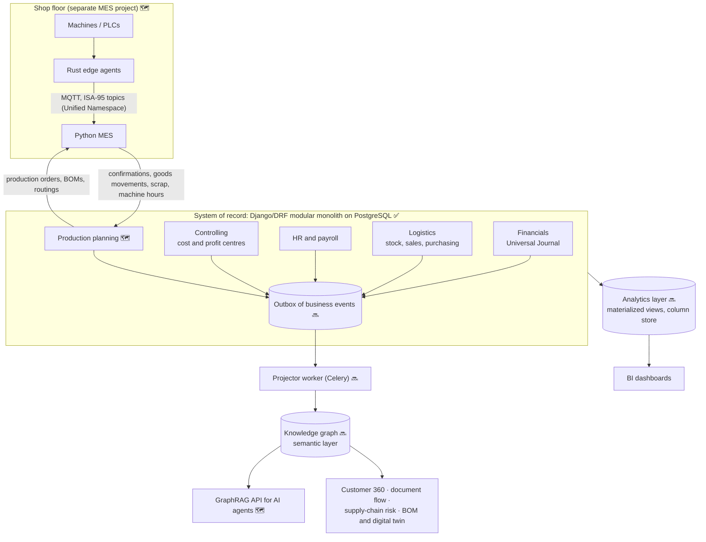

# ERP-Intelligence: architecture and vision

ERP-Intelligence is being built as more than a set of transactional modules. The goal is an ERP whose
data is **connected, explainable and ready for AI agents**, and that can stay in step with a factory's
shop floor. This document explains the target architecture, what is built today, and why the pieces
are ordered the way they are.

> **Status key:** ✅ built and tested · 🔜 next · 🗺️ planned. See the [roadmap](../README.md#roadmap).

## The idea in one picture



## Three layers, three jobs

| Layer | Job | Technology | Status |
|---|---|---|---|
| **System of record** | Every business transaction, with the rules that make the books trustworthy: double entry, gap-free numbering, row locks, immutable documents corrected only by reversal | Django/DRF, PostgreSQL | ✅ Waves 0-3 |
| **Analytics layer** | Totals over time: P&L and balance sheet by period, margin by customer and material, stock ageing, payroll cost trends | PostgreSQL materialized views, then a column store; BI dashboards | 🔜 Wave 4a |
| **Knowledge graph** | Relationships: who is connected to what, across modules, at any depth | Graph database fed from the outbox | 🔜 Wave 4b |

The relational core stays the single source of truth. The analytics layer and the knowledge graph are
**read models**: they are rebuilt from the core and never written to directly. Each answers the kind
of question it is best at:

- "What was gross margin per profit centre last quarter?" is an aggregation, so analytics answers it.
- "If this supplier stops delivering, which customers' open orders are at risk?" is a path through
  supplier → purchase orders → materials → sales orders → customers, so the graph answers it in one
  traversal instead of a long chain of SQL joins.

## Why the core is already graph-shaped

The modules built so far link every document to the ones before it and give every journal line the
dimensions of the business:

```
Customer ─┬─ Sales order ── Delivery ── Material document ── Journal entry (WA)
          │                    └─────── Invoice ──────────── Journal entry (DR) ── Payment (DZ)
          └─ Open items ───────────────────────────────────── clearing
Supplier ─── Purchase order ── Goods receipt ── Supplier invoice ── Payment (KZ)
Journal line → business partner · material · plant · cost centre · profit centre
Employee → position → org unit → cost centre → profit centre
```

These links already exist as foreign keys. The knowledge graph makes them first-class nodes and
edges, so they can be traversed, visualised and handed to an AI agent as grounded context.

## Keeping the graph in sync: the outbox pattern 🔜

1. Each service in `services.py` (post an invoice, receive goods, run payroll) writes an **event row**
   in the same database transaction as the business posting. If the posting rolls back, so does the
   event, so the two can never disagree.
2. A Celery worker reads new events in order and **upserts** the matching nodes and edges into the graph.
3. Because posted documents are immutable and corrections are separate reversal documents, events
   are append-only. The graph can be rebuilt from scratch at any time by replaying them.

## Knowledge graph, first version 🔜

- **Nodes:** BusinessPartner (with Customer and Supplier roles), Material, Plant, StorageLocation,
  CompanyCode, CostCenter, ProfitCenter, Employee, Position, OrgUnit, and the business documents
  (orders, deliveries, receipts, invoices, payments, journal entries, payroll runs).
- **Edges:** `ORDERED`, `DELIVERED_BY`, `BILLED_BY`, `PAID_BY`, `SUPPLIES`, `STOCKED_AT`,
  `POSTED_TO`, `CHARGED_TO`, `BELONGS_TO`, `REPORTS_TO`, and so on.
- **Stable identifiers:** business keys (partner numbers, material numbers, plant codes, document
  numbers), the same keys the MES will use, so shop-floor data joins the graph without mapping tables.
- **First use cases:**
  - **Customer 360:** everything about a business partner across sales, purchasing, receivables,
    payables and stock, in one query.
  - **Document flow:** order → delivery → invoice → payment, and PO → receipt → invoice → payment,
    as a traversal.
  - **Supplier dependency:** materials bought from a single supplier, and the sales they feed.
- **Graph database:** Neo4j (industry standard, Cypher), with Apache AGE (graph queries inside
  PostgreSQL) as the lighter alternative. Decided at the start of Wave 4b.

## AI readiness: GraphRAG 🗺️

Enterprise AI agents give unreliable answers when they guess at SQL over dozens of tables. Grounding
them in the graph means an answer can be traced back to the real orders, invoices and partners it came
from. Two rules carry over from the core:

- **Permissions travel with the data.** The same roles that protect the API filter what the graph
  returns. Salaries, for example, are visible to HR only today and must stay that way for an agent.
- **The graph explains, the core decides.** Agents read from the graph. Any change still goes through
  the service layer and its business rules.

## Shop floor to finance: the MES link 🗺️

A separate MES project (machines → Rust edge agents → MQTT → Python MES) will exchange data with the
ERP using the ISA-95 model, which is the standard for connecting a factory's operations to its ERP:

| Direction | What flows | ERP side |
|---|---|---|
| ERP → MES | Production orders, bills of materials, routings, material master | Production planning wave |
| MES → ERP | Operation confirmations, material issued to an order, finished goods received, scrap, machine and labour hours | Goods movements (261 issue to order, 101 receipt from order, 551 scrap), activity costs to cost centres |

Design rules:

- **The shop floor never waits for the ERP.** The MES keeps running if the ERP or the graph is down,
  and forwards its events when the link is back (store-and-forward).
- **Synchronise at business events, not sensor readings.** The ERP posts at meaningful points
  (a confirmed operation, a received batch). High-frequency telemetry stays in a time-series store;
  the graph holds the digital twin's structure and latest state.
- **One vocabulary.** MQTT topics follow the ISA-95 hierarchy (enterprise / site / area / line / cell)
  and payloads use the ERP's plant codes, material numbers and order numbers.

## Delivery order

| Wave | Delivers | Why here |
|---|---|---|
| 0-3 ✅ | Foundation, Financials, Logistics (stock, order-to-cash, procure-to-pay), HR, payroll, Controlling | Every later layer reads from the books |
| 4a 🔜 | Analytics: local PostgreSQL, materialized-view reporting, then dashboards | Needs the transaction history from Waves 1-3 |
| 4b 🔜 | Knowledge graph: outbox, projector, ontology v1, Customer 360, document flow, supplier dependency, GraphRAG endpoint | Built on the same events the analytics layer uses |
| 5 🗺️ | Production planning: bills of materials, routings, production orders | Needed for the BOM graph and the MES |
| 6 🗺️ | MES integration: MQTT / Unified Namespace bridge, ISA-95 mapping to ERP postings | Needs production orders |
| 7 🗺️ | CRM and SRM | Extends sales and purchasing; enriches Customer 360 and supplier risk |
| 8 🗺️ | SCM: demand forecasting (FastAPI ML service), MRP, supply-chain risk analysis on the graph | Needs production, suppliers and history |
| 9 🗺️ | PLM and digital twin: engineering BOMs, versions, change management | Needs production and MES data |

Each wave ends in a tested release, so the system works at every stage of the journey.
